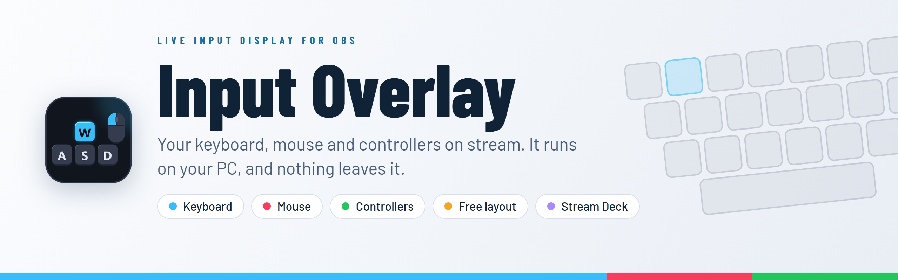
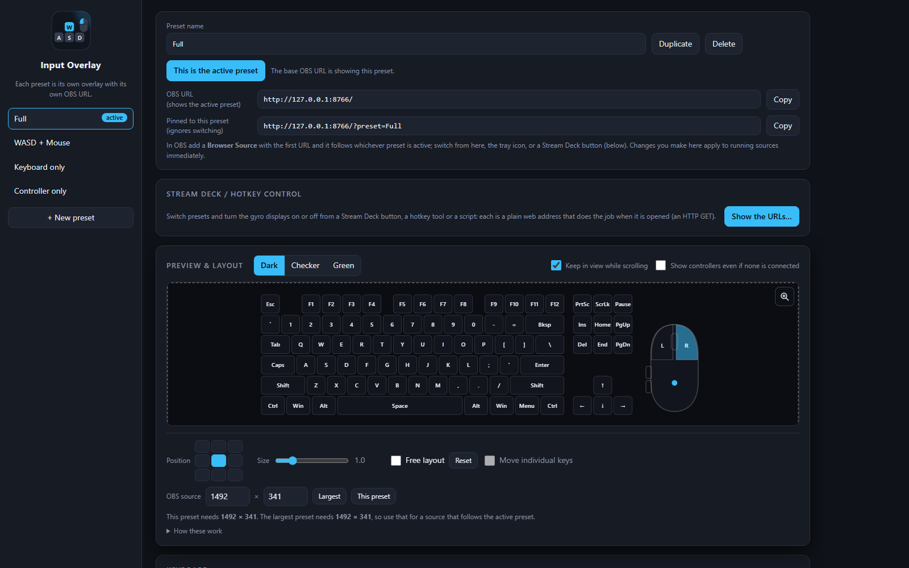
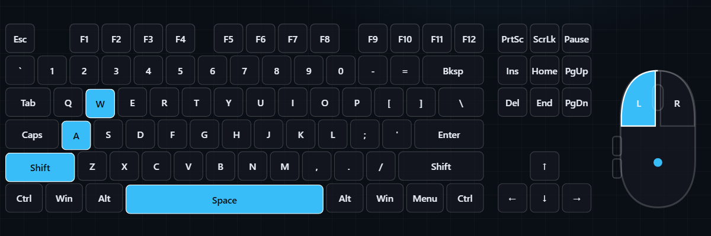
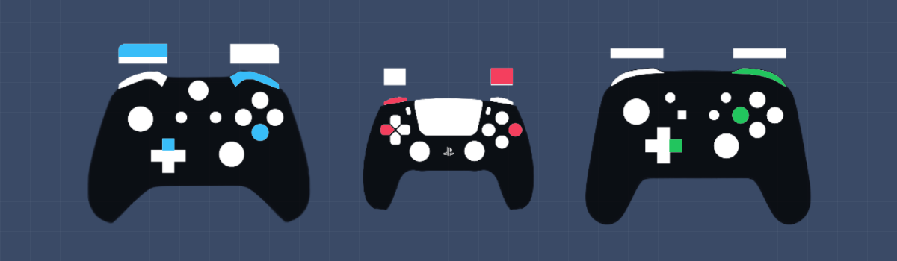
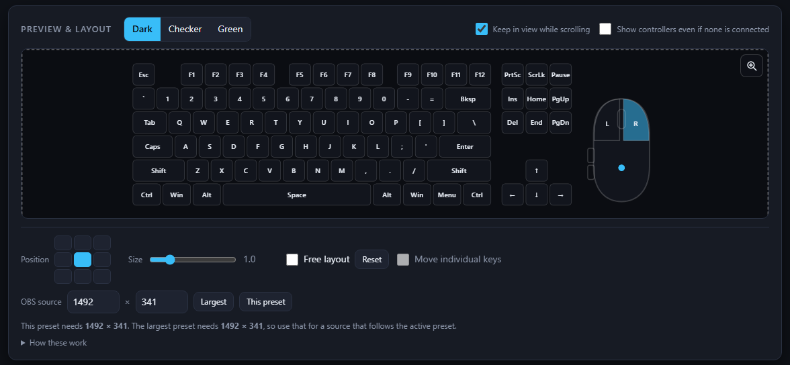
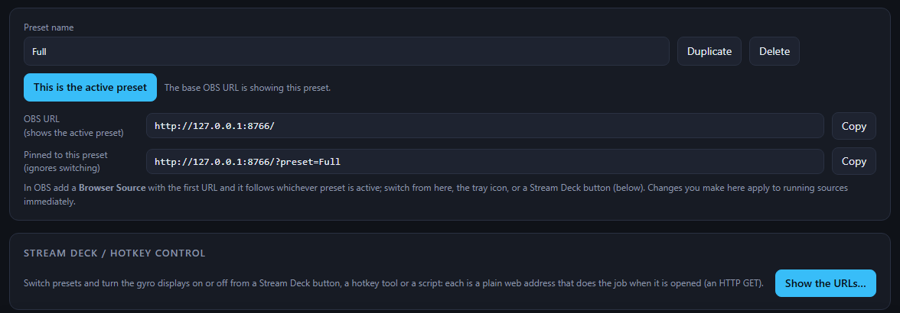
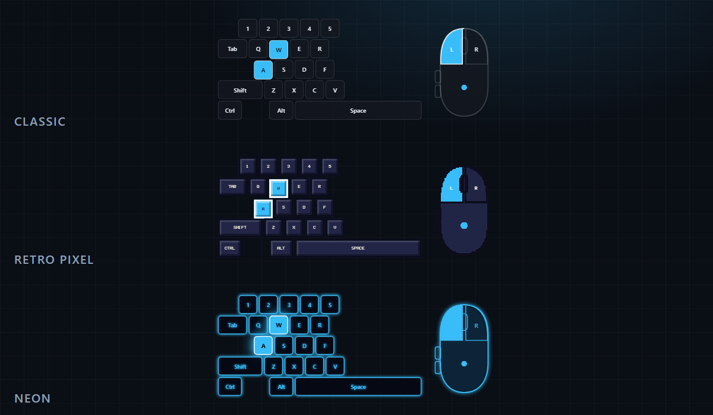
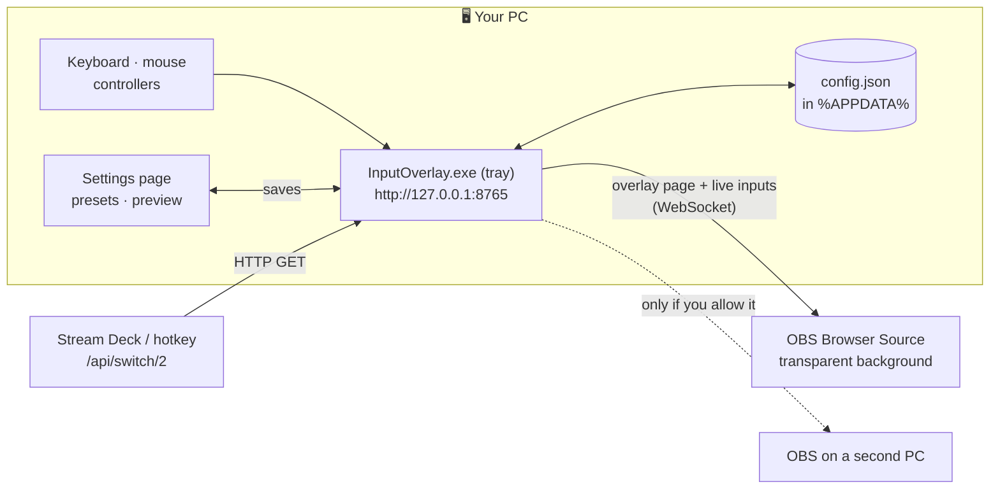
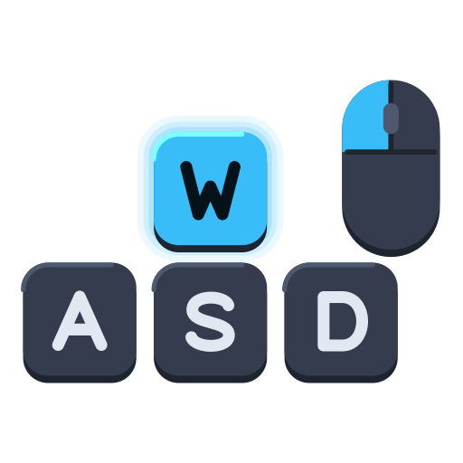

<div align="center">

<picture>
  <source media="(prefers-color-scheme: dark)" srcset="docs/images/banner-dark.png">
  
</picture>

<br><br>


<h3>
  <a href="#-what-it-does">What it does</a> ·
  <a href="#-download-and-install">Download</a> ·
  <a href="#-set-it-up-in-obs">OBS setup</a> ·
  <a href="#-how-it-works">How it works</a> ·
  <a href="#-whats-in-this-repo">Repo map</a> ·
  <a href="docs/THEMES.md">Make a theme</a> ·
  <a href="CHANGELOG.md">Changelog</a>
</h3>

<br>



<sub><i>Settings has a live preview. What you see there is what OBS shows.</i></sub>

</div>

<br>

## 🎯 What it does

Input Overlay shows your **keyboard**, **mouse** and **game controllers** live on stream, in OBS or any other program that can load a web page. Pick your highlight colour, theme and controller artwork, save several layouts as **presets**, and switch between them from a Stream Deck.

It runs on your PC as a small tray program. OBS loads the overlay from it as a Browser Source with a transparent background. Everything stays on your computer unless you turn on the optional update check.

<table>
  <tr>
    <td width="50%" valign="top">
      
    </td>
    <td width="50%" valign="top">
      <h3>⌨️ Keyboard &amp; mouse</h3>
      Show the whole keyboard, with or without the <b>numpad</b>, or only the keys you use (WASD, or your own set). Keys can be resized, and Enter and numpad Enter stay separate. The mouse shows its buttons, scroll wheel, side buttons and a movement dot, and it works in games that lock the cursor.
    </td>
  </tr>
  <tr>
    <td width="50%" valign="top">
      <h3>🎮 Controllers</h3>
      Steam Controller, Xbox, PlayStation 4 and 5, Switch Pro, Switch 2 Pro and GameCube, with analogue triggers, sticks and trackpads. Show up to <b>four at once</b> for co-op, or let <b>Auto</b> show however many are plugged in. Each gets its own artwork and, if you like, its own colour. Controllers with a gyro can tilt on screen, or drive an aim dot.
    </td>
    <td width="50%" valign="top">
      
    </td>
  </tr>
  <tr>
    <td width="50%" valign="top">
      
    </td>
    <td width="50%" valign="top">
      <h3>📐 Free layout</h3>
      Drag the keyboard, mouse and each controller wherever you want them; they snap to each other's edges. Tick <b>Move individual keys</b> to move single keys, even on top of keys you've hidden. The <b>magnifying glass</b> blows the preview up so you can place things precisely, and <b>Position</b> and <b>Size</b> keep the overlay on screen in OBS.
    </td>
  </tr>
  <tr>
    <td width="50%" valign="top">
      <h3>🎛️ Presets &amp; Stream Deck</h3>
      Build layouts like "Full", "WASD + Mouse" and "Controller only", and switch between them live, with no reload. A Stream Deck button, a hotkey tool or a script only has to open a web address. <b>Show the URLs</b> in Settings lists every one with a Copy button.
    </td>
    <td width="50%" valign="top">
      
    </td>
  </tr>
  <tr>
    <td width="50%" valign="top">
      
    </td>
    <td width="50%" valign="top">
      <h3>🎨 Themes</h3>
      <b>Classic</b>, <b>Retro Pixel</b> and <b>Neon</b> come with it, and a theme is just a folder of CSS, fonts and images, so you can <a href="docs/THEMES.md">make your own</a>. Highlight colour, opacity and size can be set for every preset at once or for one preset only.
    </td>
  </tr>
</table>

### 🖥️ Two PCs? That works too

If your game PC and your streaming PC are separate, the streaming PC's OBS can load the overlay over your network. It only answers the one PC you name, behind a secret link. See [Two-PC streaming](#-two-pc-streaming-loading-the-overlay-from-another-pc) for how to keep it private on a shared network.

<br>

## 🔧 How it works



<details>
<summary><b>The details</b></summary>
<br>

- **The program** is a Python app packed into `InputOverlay.exe`. It reads the keyboard and mouse with a system-wide hook and controllers through SDL3 (XInput as a fallback, `libusb` for GameCube adapters and the Switch 2 Pro), and serves the overlay page and Settings itself.
- **The overlay is a web page.** OBS loads `http://127.0.0.1:8765/` and gets inputs live over a WebSocket, so a preset switch or a setting change shows up instantly.
- **Only your PC can connect** unless you start it with `--allow-lan`, and web pages on other sites are refused. See [Security and privacy](#-security-and-privacy).
- **Your settings** are in `%APPDATA%\InputOverlay\config.json` (a damaged file is kept as `config.bad`), with `log.txt` next to it.
- **Nothing is sent anywhere.** The update check is off until you turn it on, and then it only asks GitHub which release is newest.

</details>

<br>

## 🚀 Download and install

1. Download the zip file from the [Releases page](../../releases/latest), unzip it anywhere, and run `InputOverlay.exe`.
2. A tray icon appears, and the settings page opens the first time.

Windows or your antivirus may warn about the download. That is a false positive; see [Antivirus warnings](#antivirus-and-unrecognised-app-warnings) below.

### 🐧 Linux

Linux has its own releases, tagged `linux-v…` on the [Releases page](../../releases) (the Windows download is the `.exe` zip). The Linux
version runs from source with Python 3.12 or 3.13: download `InputOverlay_linux-v….tar.gz`, unpack it and `cd InputOverlay`. Or clone the
repository instead:

```
git clone https://github.com/Ethral-T/input-overlay.git
cd input-overlay
```

Input capture is **X11 only**. A Wayland session, which is the default on Ubuntu and Fedora, does not give this program keystrokes or mouse input from native Wayland applications. Starting the server there still serves the overlay page, but keys pressed in a Wayland app never arrive. Use an X11 session (`DISPLAY` set, and not a Wayland compositor) for capture.

Install the system packages, then the Python packages from `requirements-linux.lock`:

```
sudo apt install python3-venv python3-pip libusb-1.0-0 xclip xdg-utils
python3 -m venv --system-site-packages .venv
.venv/bin/pip install --require-hashes --ignore-installed -r requirements-linux.lock
.venv/bin/python server.py
```

`--system-site-packages` is what lets the virtualenv import apt's PyGObject. Without `--ignore-installed`, pip treats libraries that are already installed for the system Python (such as idna, pillow, six and typing-extensions) as satisfied and skips their hash check. `--ignore-installed` puts a hash-checked copy of every locked package into the virtualenv.

`xsel` works in place of `xclip`. `xdg-utils` provides `xdg-open` for the themes folder. SDL3 is optional: install the package that provides `libSDL3.so.0` (Debian and Ubuntu: `libsdl3-0`) and controllers that SDL knows are used; without it that backend is skipped and `/dev/input/js*` is used instead.

The tray icon (`python app.py`) only has a menu when PyGObject and AppIndicator are installed:

```
sudo apt install python3-gi gir1.2-gtk-3.0 gir1.2-ayatanaappindicator3-0.1
```

`gir1.2-appindicator3-0.1` is the older package name, if the Ayatana one is not in your distro. On GNOME the icon stays hidden until the AppIndicator (KStatusNotifierItem) extension is enabled; Ubuntu ships it as `gnome-shell-extension-appindicator`. Those packages are installed for the system Python. A virtual environment created with plain `python3 -m venv .venv` cannot import them, so the menu stays missing even though apt installed them. `--system-site-packages` (in the command above) lets the environment see them, and the AppIndicator menu appears. Without these packages the server still runs, and the tray prints that Quit, Copy URL and Start at login are unavailable.

Copy URL uses `wl-copy` only when `WAYLAND_DISPLAY` is set. On X11 it uses `xclip` or `xsel`, including when `wl-copy` happens to be installed.

Settings are stored in `$XDG_CONFIG_HOME/InputOverlay` (or `~/.config/InputOverlay`). If `~/InputOverlay/config.json` or `~/InputOverlay/themes` is already there, that directory is kept so an older install is not orphaned. `INPUT_OVERLAY_HOME` overrides the location. Start at login writes `$XDG_CONFIG_HOME/autostart/input-overlay.desktop` (`~/.config/autostart` when that variable is unset). An entry with `Hidden=true` is treated as off.

`python server.py` and `python app.py` from a terminal print to that terminal. `log.txt` in the config directory is written only when there is no console (`stdout` or `stderr` is missing) or the app is the packaged program. A Linux terminal session does not create `log.txt`.

The server listens on `127.0.0.1` (unless you turn on LAN access) and does not run as root. Gamepads, the GameCube adapter and the Switch 2 Pro need the logged-in user to be allowed to open the device node. Do not make the nodes world-writable (`MODE="0666"`) and do not start the server with sudo. A udev rule with `TAG+="uaccess"` lets logind grant them to the active session. Create `/etc/udev/rules.d/70-input-overlay.rules`:

```
# Official GameCube adapter (USB 057e:0337)
SUBSYSTEM=="usb", ATTR{idVendor}=="057e", ATTR{idProduct}=="0337", TAG+="uaccess"
# Switch 2 Pro Controller (USB 057e:2069), including its hidraw node
SUBSYSTEM=="usb", ATTR{idVendor}=="057e", ATTR{idProduct}=="2069", TAG+="uaccess"
KERNEL=="hidraw*", ATTRS{idVendor}=="057e", ATTRS{idProduct}=="2069", TAG+="uaccess"
# Kernel joystick interface
SUBSYSTEM=="input", KERNEL=="js*", TAG+="uaccess"
```

Many desktops already tag `js*` this way. Replug the device after the rule is installed. `/dev/input/js*` still has to be readable by your user; if it is not, the Linux joystick backend says so and the controller picture stays disconnected.

## 🎬 Set it up in OBS

1. In **Settings** (click the tray icon, or open `http://127.0.0.1:8765/settings`), pick a preset or make your own.
   - Click keys to hide or show them, or drag across several. The quick-select buttons (All, None, Letters, Digits, WASD and so on) do it in bulk.
   - Turn the numpad, mouse and controller on or off, then choose the highlight colour, size and theme.
2. In OBS, add a **Browser Source** with the URL `http://127.0.0.1:8765/`.
3. Type the width and height that Settings shows under **OBS source** into the source's Width and Height boxes.

The source follows your **active preset**, so you never edit the URL again. Changes in Settings and preset switches show up
instantly, with no reload. To pin a source to one preset (for example a controller-only source on a second scene), use
`http://127.0.0.1:8765/?preset=<name>`.

The tray menu lets you open settings, change the active preset, copy the OBS URL (or one pinned to a preset), open the themes folder, start with Windows (or at login on Linux), and quit.
Presets are stored in `%APPDATA%\InputOverlay\config.json` on Windows. On Linux they are in `~/.config/InputOverlay` unless an older `~/InputOverlay` is already present; see [Linux](#-linux). On Windows the log is `log.txt` next to the config. On Linux that file is written only when the process has no console, or when it is packaged; a terminal run prints to the terminal instead.

### Position and size

- **Position in source** (the 3x3 picker, set per preset; centre by default) pins the overlay to a corner, edge or the middle of the
  source, so switching presets doesn't make it jump.
- Use the **Size** slider to scale the overlay instead of stretching the source in OBS, which makes it blurry.
  If the overlay (at that size) is bigger than the Browser Source, it is shrunk to fit so nothing is cut off; make the source bigger to show it at full size.
- **Free layout** (Position & size) lets you drag the keyboard, mouse and each controller to wherever you like in the preview. Pieces snap to each
  other's edges and middles. Press **Reset** to put them back in a row. Tick **Move individual keys** (it appears under Free layout) to drag single keys
  to new places; a moved key may sit on the slot of a key you have hidden, a double-click puts one back, and **Reset keys** puts them all back.
- The magnifying glass in the corner of the preview enlarges it over the whole window so you can see and arrange things in more detail (Esc closes it).
- To resize a key, drag the right edge of it in the Settings preview. It snaps to quarter-key steps, and the keys after it shift to
  follow. Double-click an edge to reset that key, or press **Reset key sizes** to clear them all.

## 🎛️ Switching presets with a Stream Deck

Anything that can send an HTTP GET works (Stream Deck, scripts, `curl`). In Stream Deck, use the built-in **Website** action with
"Access in background" ticked, or an API plugin such as BarRaider's API Ninja. Settings, in the Stream Deck card, has a **Show the URLs** button that lists
every URL with a Copy button.

| URL | What it does |
|---|---|
| `/api/switch/<name or number>` | Activate a preset by name (not case-sensitive) or by position, for example `/api/switch/2` |
| `/api/next`, `/api/prev` | Cycle through your presets |
| `/api/switch` | Report the active preset |
| `/api/gyro/tilt/toggle`, `/api/gyro/aim/toggle` | Turn the gyro tilt picture or aim dot on or off for every preset (use `on` or `off` instead of `toggle` to set it) |
| `/api/gyro/on`, `/api/gyro/off`, `/api/gyro/toggle` | Both gyro displays together |
| `/api/gyro` | Report the gyro state |

All URLs start with `http://127.0.0.1:8765`. Requests that a browser marks as cross-site are rejected, so a web page can't change your preset.

## 🎮 Controllers

**Controller style** (Settings, Controller) picks the artwork: Steam Controller, Xbox, PlayStation 4, PlayStation 5, Nintendo Switch,
Switch 2 Pro or GameCube. **Auto-detect** (the default) picks one from the connected controller. Unknown or generic pads get the Xbox art.
Controllers are read through SDL3, with XInput as a fallback.

### More than one controller
Set **Controllers to show** (Settings, Controller) to 2, 3 or 4 to show several controllers side by side, or to **Auto** to show as many as are connected. They appear in the order the computer finds
them, so the first one plugged in is player 1, and each gets the artwork that matches it (an Xbox pad next to a PlayStation pad is fine). With **A colour
for each player** on, players 2 to 4 light up red, green and amber and player 1 keeps your highlight colour. A GameCube adapter in PC mode reports all four
ports whether or not anything is plugged in, so when there is more than one, a controller there appears the first time you touch it. Gyro tilt and aim boxes work
for each controller on its own.

### Steam Controller
Trackpads have no click switch, so a "click" is pressure past a threshold. Adjust it with **Trackpad click pressure** in Settings, Controller.

### Gyro
For controllers that report motion (Steam Controller, PlayStation 4 and 5, Switch Pro), turn on **Gyro** in Settings, Controller:

- **Tilt the picture:** the controller leans the way you turn the real one, then settles back to level.
- **Aim dot:** a box beside the controller has a dot that follows your turn, leaves a fading trail and drifts back to the middle.

A gyroscope measures how fast the controller turns, not where it points, so both displays recentre by themselves. **Gyro sensitivity**
sets how far the picture leans and how fast the dot moves. The Switch 2 Pro, GameCube adapters and Xbox pads don't report gyro yet.

### GameCube controllers
Two kinds of adapter work, and both pick the GameCube artwork automatically:

- **Mayflash and similar adapters in PC mode** show up as an ordinary gamepad. Nothing to install.
- **The official Nintendo adapter (WUP-028), or a Mayflash in Wii U mode,** needs a **WinUSB driver**. Run [Zadig](https://zadig.akeo.ie/),
  choose "WUP-028" (Options, List All Devices), pick WinUSB and press Install. Close Dolphin while the overlay is running.
  Uninstall the driver in Device Manager if you want the adapter back as a normal device.

Only one program can use an adapter in Wii U mode at a time, so the overlay and a game can't both read it. Since a client update on
21 January 2026, Steam doesn't open Wii U-mode adapters unless you start it with `-enable-libusb-gamecube`, and then Steam and the
overlay will fight over the adapter. **To play and stream at the same time, put the adapter in PC mode.**

### Switch 2 Pro Controller
It is read over **USB** (not Bluetooth), so plug it in with a cable. Nothing needs installing. It gets its own artwork, including the
C button and the GL/GR back paddles. ZL and ZR show as on/off buttons.

**Steam takes exclusive hold of this controller.** If Steam is running the overlay can't read it, so quit Steam first (tray icon, Exit),
or give the controller a Gamepad layout in Steam so it shows up as a virtual Xbox pad (the overlay then uses the Xbox art unless you pick Nintendo Switch).

## 🎨 Themes

Pick a theme in Settings, Appearance, **Theme**:

- **Classic:** the original look.
- **Retro Pixel:** 8-bit, with square bevelled keys, a pixel font, and a pixelated mouse and controller.
- **Neon:** glowing outlines in your highlight colour.

Some settings have an **all presets / this preset** tag you can click: **all presets** uses one value everywhere, **this preset**
lets each preset keep its own. This covers Theme, Highlight colour, Gyro, Fill opacity, Overall opacity and Mouse Button Invert.

**Make your own theme:** a theme is a folder of CSS, fonts and images. Copy `docs/theme-template/`, read [docs/THEMES.md](docs/THEMES.md), then drop the
folder into your themes folder (**Open themes folder** in Settings or the tray menu) and press **Refresh** next to the theme picker.
Themes can't run code and can't load anything from the internet, but only install themes from people you trust.

## 🔗 URL options

<details>
<summary><b>Every option</b></summary>
<br>

Every setting can also be overridden in the Browser Source URL, for example `http://127.0.0.1:8765/?theme=pixel&controller=xbox`.

| Option | Values |
|---|---|
| `preset` | Preset name |
| `kb` | `full`, `compact`, `off` |
| `numpad` | `1` or `0`: include the numeric keypad |
| `pads` | `1` to `4`, or `auto`: how many controllers to show |
| `mouse` | `1`, `0` |
| `pad` | `auto` (only while connected), `1`/`on`, `0`/`off` |
| `accent` | Highlight colour, for example `f43f5e` or `orange` |
| `scale`, `opacity`, `fill` | Size, overall opacity (0.1-1) and fill opacity of the key, mouse and controller backgrounds (0-1) |
| `sens`, `tpt`, `tprot` | Mouse movement sensitivity, trackpad click pressure (0-1), trackpad tilt in degrees |
| `align` | `tl` `tc` `tr` `ml` `mc` `mr` `bl` `bc` `br` |
| `theme` | `default`, `pixel`, `neon`, or the folder name of your own |
| `controller` | `auto`, `steam`, `xbox`, `ps4`, `ps5`, `switch`, `switch2`, `gamecube` |
| `gyro`, `gsens` | `off`, `tilt`, `aim` or `both`, and its sensitivity |
| `static` | `1` doesn't connect to real input (for screenshots and demos) |
| `debug` | `1` shows the detected controller, button presses and gyro values in the corner |

</details>

## 🛟 When something's off

- **The overlay doesn't update in OBS after an upgrade:** right-click the source, Properties, **Refresh cache of current page**.
- **A mouse side button is the wrong one:** tick **Mouse Button Invert** in Settings.
- **Keys don't show in a game:** games running as administrator can block input hooks from a normal program. Run Input Overlay as administrator too.
- **The controller isn't detected:** add `?debug=1` to the URL to see what the program detects and which inputs it receives.
- **The overlay is blank in OBS after starting the PC:** the overlay page is served by the Input Overlay program itself, so if OBS starts before it (for example when both start with Windows) the Browser Source loads nothing and does not retry on its own. Start Input Overlay first, or tick the Browser Source option **Refresh browser when scene becomes active**, or right-click the source, Properties, **Refresh cache of current page**.
- **Numpad digits don't light:** they only report while NumLock is on. Numpad Enter lights its own key, separate from the main Enter.

## 🔔 Updates

**The update check is off by default, so out of the box nothing leaves your computer.** If you want it, tick **Check for new versions automatically**
in Settings, About. About once a day the program then asks GitHub which release of this project is the newest. If yours is older, Settings shows a banner with
a link to the release page and the tray menu gets an "Update available" item. Nothing is downloaded or installed for you: download the new zip and unzip it over
the old folder. The request carries no information about you or your computer beyond the program's name and version, which are in the request itself.
**Check now** (Settings, About) asks once, only when you press it, whether or not the automatic check is on.

## 🌐 Two-PC streaming (loading the overlay from another PC)

By default the overlay answers **only the PC it runs on**. If your game PC and your streaming PC are separate, the streaming PC's OBS can load the
overlay from the game PC. The program refuses to listen on the network unless you say exactly which PC may connect, and it protects the connection
in layers:

1. **One named PC.** Start the program with `--host 0.0.0.0 --allow-lan 192.168.1.50` (use the streaming PC's address; you can name more than one,
   or a small network such as `192.168.1.0/24`). Anything else, including your neighbours and other devices in your home, is refused, even if they
   know the port and the secret. A whole network such as `10.0.0.0/8` is not accepted: the widest allowed is a `/24`.
2. **A secret link.** The first time, the program makes a long random secret and saves it in `%APPDATA%\InputOverlay\lan-token.txt` (delete the file
   for a new one). Settings then shows a "Another PC (LAN access)" card with the link to put in the streaming PC's OBS Browser Source:
   `http://192.168.0.10:8765/?token=…`. The first load leaves a cookie, so everything the page does afterwards is covered too. Treat the link like a
   password. This PC itself never needs the secret.
3. **Guessing doesn't work.** An address that sends ten wrong secrets in a minute is shut out for five minutes.

For the shortcut that starts the program, add the options after the exe, for example `"C:\...\InputOverlay.exe" --host 0.0.0.0 --allow-lan 192.168.1.50`.
Windows Firewall will ask whether to allow the program: allow it on **Private** networks only.

**What this does not do: it does not encrypt.** The overlay is plain `http`, so on a network where other people can capture traffic (an apartment
building, a dorm, shared or public Wi-Fi, a hotel), someone could read the keystrokes on the wire even though they cannot connect. To be sure nobody
can, use one of these:

- **A direct cable between the two PCs** (a network of just those two). Give them fixed addresses, such as 10.10.10.1 and 10.10.10.2, and use
  `--host 10.10.10.1 --allow-lan 10.10.10.2`. Nothing else is on that wire.
- **A VPN between the two PCs**, such as [Tailscale](https://tailscale.com) (free). Use the game PC's VPN address for `--host` and the streaming PC's
  for `--allow-lan`; the VPN encrypts everything and nobody else on your building's network can see it.
- **https:** give the program a certificate with `--tls-cert cert.pem --tls-key key.pem`. OBS only trusts certificates that Windows trusts, so the
  streaming PC has to trust the certificate (for example one you made with your own certificate authority, installed there).

Do not use `--host 0.0.0.0` on a shared network without one of these.

## 🔒 Security and privacy

The program listens on `127.0.0.1` only, so nothing outside your PC can connect, and it refuses requests from other websites, because
any web page could otherwise read your keystrokes from a local server. It won't listen on the network at all unless you start it with `--allow-lan` (see *Two-PC streaming* above).

There is no password: it blocks websites, not other programs. Any other program running on your PC, and any other Windows account that is logged in at
the same time (fast user switching, remote desktop), can connect to the same local address and read what the overlay shows. That is the same reach as
any keyboard logger on your machine, so only run it on a PC and account you trust.

The keyboard hook is global: the overlay shows keys typed in any window, **including passwords**. Hide the source on sensitive screens.

## 🛡️ Antivirus and "unrecognised app" warnings

Windows SmartScreen, browsers and some antivirus scanners (including the combined results on VirusTotal) may flag the download or warn
that it is "unrecognised". This is a **false positive**, and it is common for tools like this. The reasons:

- **A global keyboard hook.** To show your keys in any window, the program uses a system-wide keyboard and mouse hook. That is how keyloggers
  work, so heuristic scanners treat it as suspicious. Input Overlay only sends what it sees to `127.0.0.1` (your own PC), and the source is open for you to check.
- **Not code-signed.** The program has no paid code-signing certificate, so SmartScreen shows "Windows protected your PC" until enough
  people have downloaded the file to build a reputation. Every new build starts from zero.
- **Built with PyInstaller.** The program is Python packed into an `.exe`, which is also how a lot of real malware is packaged. Scanners
  often flag the packer itself, so even a "hello world" PyInstaller app can trigger detections.
- **Direct USB access and bundled DLLs.** GameCube adapter and Switch 2 Pro support talk to the device through `libusb`, and gamepads go
  through `SDL3`. Low-level device access plus unsigned DLLs is another pattern scanners score as risky.
- **A local web server and a tray icon,** which malware also uses. It can also look on GitHub once a day for a newer version, but only if you turn that on.
- **Few downloads.** Scanners lean on reputation, and a new small project has none yet.

**What you can do:** build it from source (below), read the code, or compare the zip's SHA-256 with the `.sha256.txt` file on the
Releases page. If your antivirus quarantines it, add an exclusion for the install folder, but only for a copy from this repository's
Releases page or one you built yourself.

## 🧰 Build from source

<details>
<summary><b>Build, test and edit the artwork</b></summary>
<br>

You need Python 3.12. The packaged program is built on Windows.

```
build.bat            builds dist\InputOverlay\InputOverlay.exe (a folder: starts fast, fewer antivirus false positives)
build.bat onefile    builds a single dist\InputOverlay.exe (slower to start)
```

The build also needs two DLLs in `lib\`: `SDL3.dll` (the official SDL3 Windows x64 release from
[libsdl-org/SDL](https://github.com/libsdl-org/SDL)) and `libusb-1.0.dll` (libusb 1.0.30, `VS2022\MS64\dll` from the Windows .7z at
[libusb releases](https://github.com/libusb/libusb/releases)). Both are already included in the repository, and the build checks them against `lib/SHA256SUMS.txt`. Distribute the whole `dist\InputOverlay` folder.

Python packages are split so each platform installs only what it uses:

| File | What it is |
|---|---|
| `requirements.txt` | Shared: the web server, the tray icon, and Pillow |
| `requirements-windows.txt` | Shared, plus pynput |
| `requirements-linux.txt` | Shared, plus python-xlib |
| `requirements-dev.txt` | The Windows build: Windows requirements plus PyInstaller |

Hashes are in `requirements-windows.lock`, `requirements-linux.lock`, and `requirements-dev.lock`. Install with `--require-hashes`. Regenerate a lock with `pip-compile --allow-unsafe --generate-hashes --strip-extras` after changing its `.txt` file. Compile the Windows locks on Windows and the Linux lock on Linux, so each file only picks up that platform's packages. `requirements-constraints.txt` keeps the shared packages on the same versions in both locks.

Release tags are `v` plus the number in `version.py`; the build refuses a tag that doesn't match, so change `version.py` before tagging.

To develop, run `python server.py` for the server in a console with no tray icon. Options: `--port 8765`, `--host 127.0.0.1`, `--pad N` (which controller to use when several are
connected), and the LAN options described under *Two-PC streaming*.

**Command-line options.** `InputOverlay.exe` takes the same options as `server.py`: `--port N` (use a different port, for example if
something else already uses 8765), `--host` (default `127.0.0.1`), `--pad N`, and for two-PC streaming `--allow-lan ADDRESS` plus optionally `--tls-cert` and `--tls-key`. If you change the port, use it in the OBS Browser Source
URL and in your Stream Deck URLs too (for example `http://127.0.0.1:8800/`).

**Tests.** `pip install -r requirements-test.txt`, then `python -m pytest tests`. The things that need a real keyboard, controller, OBS or a second PC are listed in [docs/TESTING.md](docs/TESTING.md).

On Linux, install with `pip install --require-hashes -r requirements-linux.lock` and see [Linux](#-linux) for the system packages, the X11 limit, and device access. Keyboard, mouse buttons, scroll and mouse movement are read with XInput2. Controllers come from `/dev/input/js*` when that device is readable, and the GameCube adapter and Switch 2 Pro use the system `libusb-1.0`. The tray app (`python app.py`) uses a desktop autostart entry instead of the Windows Run key.

**Controller artwork** is layered SVG: one named group per part, drawn dark and inverted by the overlay, so a new controller is a matter
of drawing the parts and naming the groups. The original files are in `assets/controllers/` and the copies the overlay uses are in
`overlay/img/`. Keep the group ids if you edit one, and see the `LAYERED` table in `overlay/index.html` for how parts map to inputs.

</details>

<br>

## 📁 What's in this repo

```text
input-overlay/
├── app.py                        ← the tray program and its start-up
├── server.py                     ← the local web server, input hooks and controller backends
├── config.py                     ← presets and settings: loading, cleaning and saving
├── themes.py                     ← finds the built-in and your own themes
├── gcadapter.py · switch2.py     ← GameCube adapter and Switch 2 Pro over USB (usbcommon.py: the libusb they share)
├── appicon.py                    ← draws the logo and the .exe icon
├── overlay/
│   ├── index.html                ← the overlay OBS loads
│   ├── settings.html             ← the Settings page and its live preview
│   ├── keyboard.js               ← key layout and drawing
│   ├── themes/                   ← Classic, Retro Pixel and Neon
│   └── img/                      ← controller artwork the overlay uses
├── assets/
│   ├── controllers/              ← the original controller SVGs
│   └── logo-keys.svg             ← the logo's keys and mouse, for Stream Deck and the like
├── docs/
│   ├── THEMES.md · theme-template/   ← how to make a theme
│   ├── TESTING.md                ← what to try by hand before a release
│   └── images/                   ← banner and pictures for this page
├── tests/                        ← automated tests (pytest)
├── lib/                          ← SDL3.dll and libusb, with SHA256SUMS.txt
├── build.bat · InputOverlay.spec ← builds the .exe (PyInstaller)
├── requirements*.txt · *.lock    ← Python packages, pinned with hashes
├── CHANGELOG.md
└── THIRD_PARTY_NOTICES.md
```

<br>

## 🎨 Look and feel

<p>
  
  
  
  
  
</p>

- **The Settings page follows your highlight colour**, live as you change it.
- **Every key label is the same size** and sits on one line, in every theme.
- **The overlay shrinks to fit** its Browser Source, so nothing is cut off at the bottom or right in OBS.
- **The logo** is the W key lit and the left mouse button pressed, because that is what the program shows.

<br>

## 📄 Licence

Input Overlay is free software under the [MIT licence](LICENSE). It bundles other open-source components (SDL3, libusb and several
Python packages) that keep their own licences; see [THIRD_PARTY_NOTICES.md](THIRD_PARTY_NOTICES.md). Xbox, PlayStation, Nintendo, Steam and
the other product names belong to their owners; this project is independent and not affiliated with them.

<br>

---

<div align="center">
  
  <br>
  <sub>Input Overlay · MIT licensed · Windows · Built with Claude</sub>
</div>
